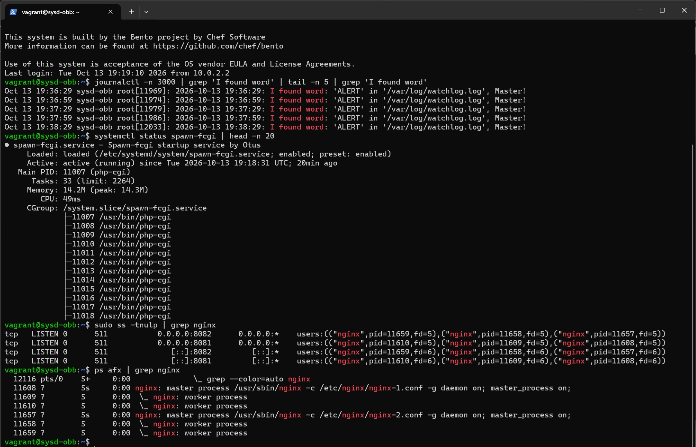
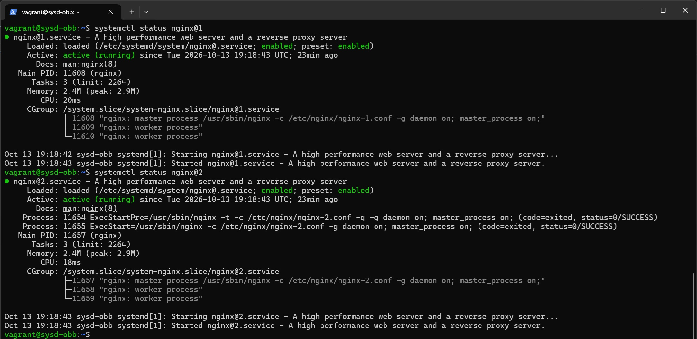
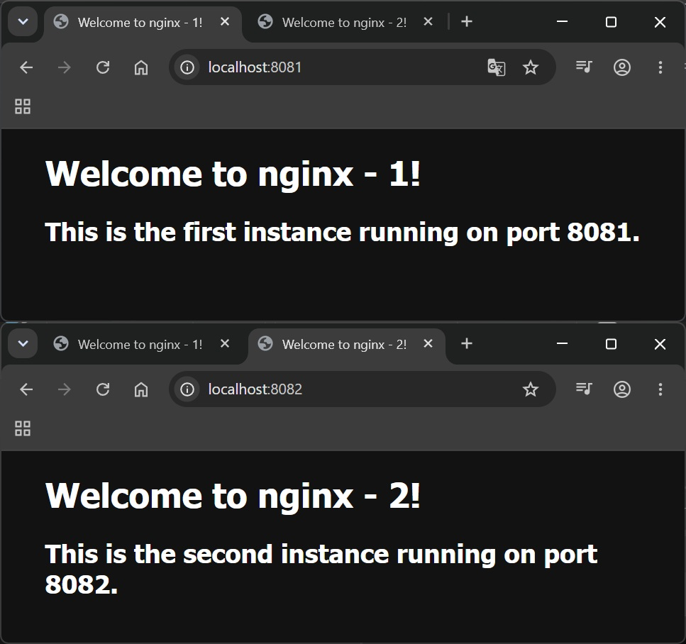

# Домашнее задание
##  Systemd - создание unit-файла
### Задание

- Написать service, который будет раз в 30 секунд мониторить лог на предмет наличия ключевого слова (файл лога и ключевое слово должны задаваться в /etc/default).;
- Установить spawn-fcgi и создать unit-файл (spawn-fcgi.sevice) с помощью переделки init-скрипта (https://gist.github.com/cea2k/1318020);
- Доработать unit-файл Nginx (nginx.service) для запуска нескольких инстансов сервера с разными конфигурационными файлами одновременно..

## Решение

### Vagrant 2.4.9, VirtualBox 7.2.16, на хосте с ОС Windows 11


[Vagrantfile](Vagrantfile) файл создает ВМ с гостевой ОС bento/ubuntu-24.04 со следующими параметрами:
* ОЗУ 2048Мб, CPU 2;
* выполняет провижинг:
  * пробрасвает порты 8081 и 8082 с хоста на 8081 и 8082 гостевой ОС;
  * создает сервис для мониторинга лог файла [unit.sh](unit.sh);
  * устанавливает spawn-fcgi и создает для него юнит [spawn.sh](spawn.sh);
  * устанавливает nginx и запускает 2 инстанса nginx`а [nginx.sh](nginx.sh).

После выполнения сценария посмотрим:
```bash
# Содержимое журнала на предмет нахождения ключевого слова
journalctl -n 3000 | grep 'I found word' | tail -n 5 | grep 'I found word'

# Убедимся, что сервис для spawn-cgi работает
systemctl status spawn-fcgi | head -n 20

# Проверим работу 2х инстансов nginx`а
sudo ss -tnulp | grep nginx

ps afx | grep nginx
```



```bash
# Убедимся, что все 2 сервиса для nginx работают
systemctl status nginx@1

systemctl status nginx@2
```



Посмотрим с хоста дефолтные страницы 2х nginx`ов

